# Procedural Motion · A Motion-Design Lab in Code

> Classic motion-design styles recreated frame by frame with pure code — no After Effects, no drawing tablet. Every frame is computed.

Each style is a parametric script plus a rendered MP4 and a technique note. Change a few constants, rerun, and you get your own version.

[中文](README.md) · [Style-by-style guide (Chinese)](GUIDE.md)

## Styles

| # | Style | Preview | Core technique |
|---|-------|---------|----------------|
| 01 | Frame-by-Frame |  | Procedural line boil + animating on twos |
| 02 | Isometric 2.5D | 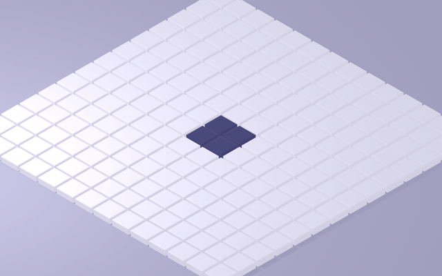 | Headless Blender EEVEE + orthographic camera + wave scheduling |
| 03 | Flat Vector |  | Easing library + the 12 principles (overshoot, squash, anticipation) |
| 04 | Line Art | 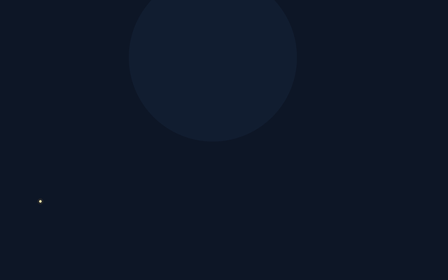 | Arc-length resampling + stroke reveal |
| 05 | 3D Render | 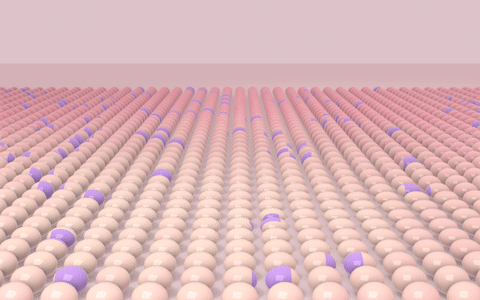 | Soft height field, normal tilt, jelly squash, subsurface scattering |
| 06 | Shape Morph | 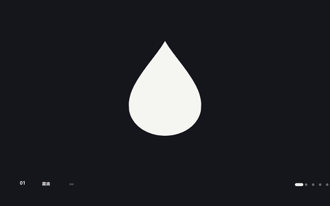 | Arc-length resampling + anchor alignment + per-point easing |
| 07 | Sticker Explainer |  | Oversized canvas + camera moves + three-layer sticker construction |
| 08 | Cyberpunk HUD | 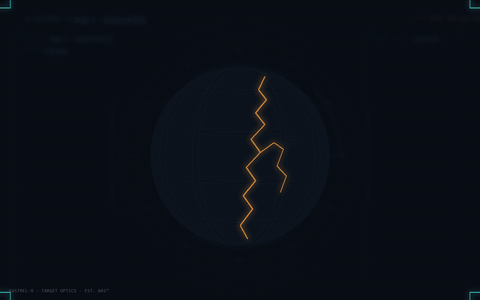 | Screen-blend glow + parametric wireframe globe + deterministic noise |
| 09 | Collage Cut-out | 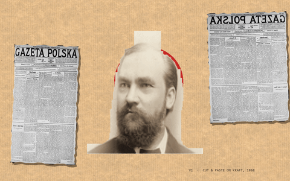 | Zero-asset collage + halftone + 12 fps stepping |
| 10 | Aurora Glassmorphism |  | Anisotropic blobs + fbm warp + glass SDF refraction + dispersion |
| 11 | Geometric Bauhaus | 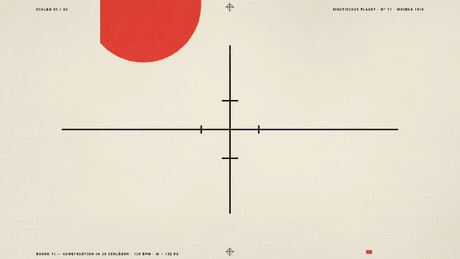 | Four-color separation + knockout overprint + 12-tooth escapement |
| 12 | Synthwave Neon Drive | 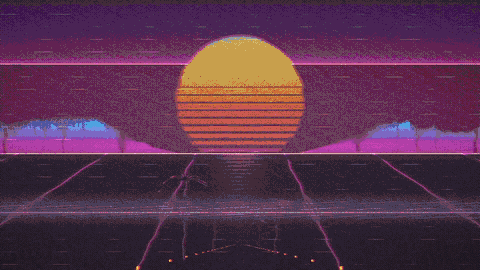 | Pure-numpy raycaster + striped sunset + VHS chroma delay |
| 13 | Pixel Art | 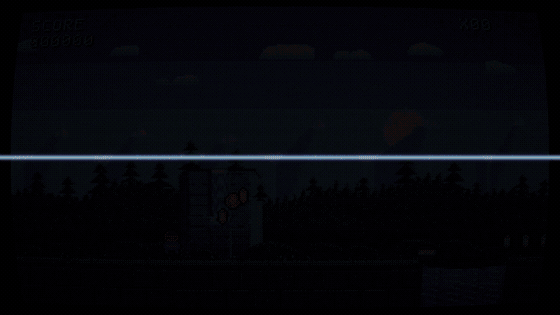 | 320×180 indexed color + LUT palette rotation + ordered dithering |
| 14 | Liquid Motion | 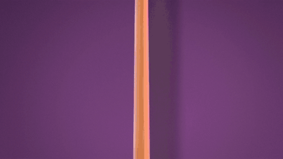 | Full-screen SDF smooth union + thickness shading + mip bloom |
| 15 | Variety Captions | 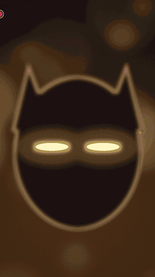 | Five-layer per-character outline + spring entrance + wave jitter |

## Requirements

| Dependency | Used for |
|---|---|
| Python 3.10+ | every script (built with 3.12) |
| Pillow + numpy | styles 01 / 03 / 04 / 10 / 11 / 12 / 13 |
| Pillow + numpy + scipy | style 14 (scipy only for the glyph distance transform) |
| ffmpeg | PNG frames → MP4 / GIF |
| Blender 4.5 | style 02 only (headless `blender -b`) |

```bash
pip install pillow numpy scipy
```

## Quick Start

```bash
# 01 frame-by-frame: render 48 frames, then encode
cd 01-frame-by-frame
python make_boom.py all
ffmpeg -y -framerate 12 -i frames/f_%03d.png -c:v libx264 -preset slow -crf 18 -pix_fmt yuv420p -r 24 -movflags +faststart output.mp4

# 03 flat vector: 60 fps remaster
cd 03-flat-vector
python make_flat_v2.py all
ffmpeg -y -framerate 60 -i frames2/f_%03d.png -c:v libx264 -preset slow -crf 17 -pix_fmt yuv420p -movflags +faststart output_v2_60fps.mp4

# 13 pixel art: 600 frames in about a minute
cd 13-pixel-art
python make_pixel.py all 4
ffmpeg -y -framerate 60 -i frames/f_%03d.png -c:v libx264 -preset slower -crf 18 -pix_fmt yuv420p -movflags +faststart output.mp4
```

Full commands for every style are in the Chinese [README](README.md#快速开始).

## Design Decisions

1. **Frame rate follows the style.** UI and flat motion start at 60 fps; frame-by-frame animation is animated on twos (12 fps drawings, 24 fps encode) because a higher rate kills the hand-drawn feel.
2. **Timing curves are the soul.** The same two keyframes with `linear` and `easeOutBack` are two different pieces. Style 03 ships a complete Python easing library.
3. **Parameterize everything.** Colors, durations and sizes are constants at the top of each script. These videos are not "made", they are "described".

## Why No Frame Sequences in the Repo?

PNG frames are intermediates — an 8-second 60 fps video is 480 images and hundreds of MB. The scripts are the source; frames can always be re-rendered. The repo keeps only scripts, MP4s and preview GIFs.

## License

[MIT](LICENSE)
