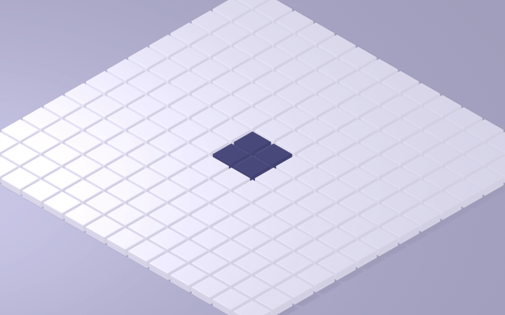
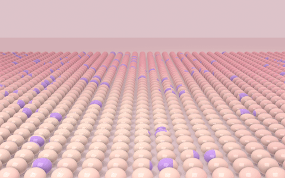
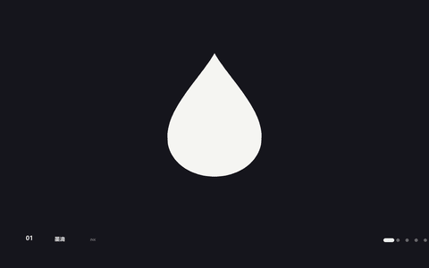
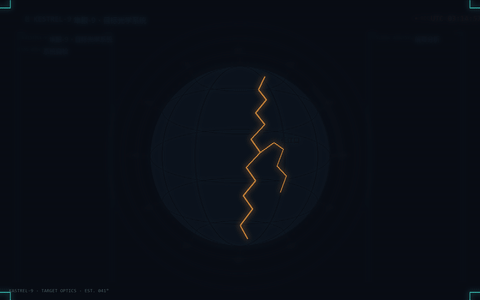
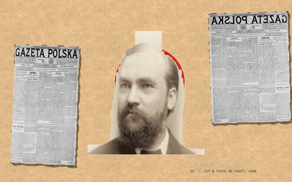
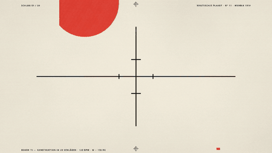
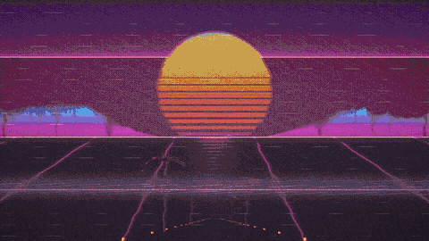
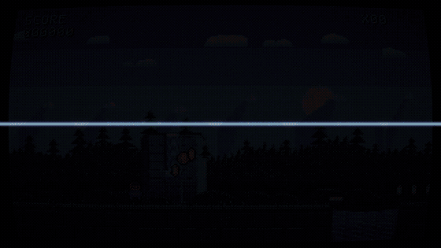
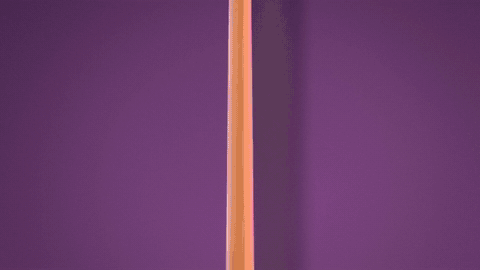
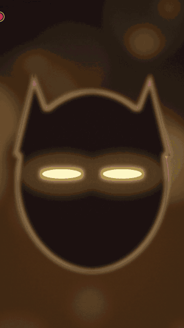

# Procedural Motion · 程序化动效实验室

> 用纯代码复刻经典动效风格 —— 不用 AE、不用手绘板，每一帧都是数学画出来的。
> Recreating classic motion-design styles from scratch with code (PIL · Blender · ffmpeg).

每个风格 = 一份参数化脚本 + 一篇知识文档 + 一段成片。改几个常量重跑一遍，就能出你自己的版本。

## 已完成风格

| # | 风格 | 预览 | 核心技术 | 文档 |
|---|------|------|----------|------|
| 01 | 逐帧手绘 Frame-by-Frame |  | 程序化"线条沸腾" + 一拍二（12fps 绘制 / 24fps 编码） | [README](01-frame-by-frame/README.md) |
| 02 | 等轴 2.5D Isometric |  | Blender 无头 EEVEE + 正交等轴相机 + 波前调度动画 | [README](02-isometric-2.5d/README.md) |
| 03 | 扁平矢量 Flat Vector |  | 缓动函数库 + 动画十二法则（回弹/挤压拉伸/预备动作） | [README](03-flat-vector/README.md) |
| 04 | 线条动画 Line Art |  | 单路径弧长采样 + 描边进度揭示（SVG stroke-dashoffset 的代码版） | [README](04-line-art/README.md) |
| 05 | 3D 渲染 3D Render |  | 软膜高度场：解析波+压坑、法线倾斜、果冻压扁、次表面散射 | [README](05-3d-render/README.md) |
| 06 | 形变动画 Shape Morph |  | 弧长重采样 + 锚点对齐 + 逐点缓动插值（SVG 形状插值） | [README](06-shape-morph/README.md) |
| 07 | 贴纸风科普 Sticker Explainer |  | 超大画布 + 相机运镜裁剪 + 贴纸三层结构 | [README](07-sticker-explainer/README.md) |
| 08 | 赛博朋克 HUD Cyberpunk FUI |  | 辉光 screen 混合 + 参数化线框球 + 确定性噪声数据流 | [README](08-cyberpunk-hud/README.md) |
| 09 | 拼贴剪贴 Collage Cut-out |  | 零素材程序拼贴 + 半调网点化 + 12fps 逐格步进 | [README](09-collage-cutout/README.md) |
| 10 | 弥散渐变玻璃拟态 Aurora Glassmorphism |  | 各向异性光斑 + fbm 扭曲 + 透视玻璃 SDF 折射 + 液态玻璃色散 + bloom | [README](10-aurora-glass/README.md) |
| 11 | 几何构成包豪斯 Geometric Bauhaus |  | 四色分色版 + 挖空套印 + 卡片翻转级联 + 12 齿擒纵 + 印刷纸纹 | [README](11-bauhaus/README.md) |
| 12 | 复古 Synthwave Neon Drive |  | 纯 numpy 光线投射 3D + 条纹落日 + 无限霓虹网格 + 磁带时间重映射 + VHS 色度延迟 | [README](12-synthwave/README.md) |
| 13 | 像素风 Pixel Art |  | 320×180 索引色 + 128 语义槽 × 6 时段 LUT + 调色板轮换 + 有序抖动 + CRT 扫描线 | [README](13-pixel-art/README.md) |
| 14 | 液态流动 Liquid Motion |  | 全屏 SDF 平滑并集 + 厚度定色 + 球冠高度场法线 + 影棚反射 + 波前水淹 + mip bloom | [README](14-liquid/README.md) |
| 15 | 综艺花字 Variety Captions |  | 单字五层叠描边（挤出×2/外描边/白描边/渐变/高光）+ 弹簧逐字入场 + 波浪抖动 + 竖屏构图 | [README](15-variety-caption/README.md) |

## 风格 Roadmap（目标 15 种，持续更新）

- [x] 01 逐帧手绘 —— 爆炸循环，线条沸腾，一拍二
- [x] 02 等轴 2.5D —— 马林巴瓷砖，24fps 与 60fps 双版本对比
- [x] 03 扁平矢量 —— 圆点一镜长成太阳，24fps 与 60fps 双版本对比
- [x] 04 线条动画 —— 一笔画：种子 → 城市 → 圆日
- [x] 05 3D 渲染 —— 柔软着陆：气球字 + 铬球句号 + 软膜果冻球海（附运动学波/刚体颗粒两版对比）
- [x] 06 形变动画 —— 一滴墨 → 咖啡 → 日落 → 海鸥，四幕形变
- [x] 07 贴纸风科普 —— 超大画布运镜：一部手机里藏着多少种元素？
- [x] 08 赛博朋克 HUD —— 隼眼-9：开机、搜索、锁定长江口
- [x] 09 拼贴剪贴 —— 绅士照剪开脑袋，星云蹦出来（12fps 逐格）
- [x] 10 弥散渐变玻璃拟态 —— 极光打底，三块磨砂玻璃浮上来，液态玻璃珠长成透镜再收成句号
- [x] 11 几何构成包豪斯 —— 圆方三角红黄蓝，120 BPM 用 20 拍把一张海报搭起来，中途整张翻版再转回
- [x] 12 复古 Synthwave —— 霓虹网格 + 条纹落日 + 跑车冲向地平线，磁带故障与 VHS 色度延迟
- [x] 13 像素风 Pixel Art —— 320×180 索引色，从清晨一路走到星夜，水波和星星只转色号不重画
- [x] 14 液态流动 Liquid Motion —— 一滴水落下、弹跳、融合、跃起、决堤淹没全屏，退去时留下液态字标 drop
- [x] 15 综艺花字 Variety Captions —— 竖屏 9:16，一个字的五层描边叠出综艺感，三只猫三种情绪

## 快速开始

<details>
<summary><b>环境依赖</b>（点开）</summary>

**逐个拆解**：[GUIDE.md](GUIDE.md) —— 15 个风格从后往前讲，本质、关键手法、踩过的坑。

| 依赖 | 用途 | 备注 |
|------|------|------|
| Python 3.10+ | 全部脚本 | 作者用 3.12 |
| Pillow + numpy | 01 / 03 / 04 / 10 / 11 / 12 / 13 渲染 | `pip install pillow numpy` |
| Pillow + numpy + scipy | 14 渲染（scipy 只用于字形的距离变换） | `pip install pillow numpy scipy` |
| ffmpeg（任意 PATH 版本） | PNG 帧 → MP4 / GIF | 编码命令见各文档 |
| Blender 4.5 | 仅 02 | 无头模式 `blender -b`，装了 4.x 大概率能跑 |

</details>

```bash
# 01 逐帧手绘：渲染 48 帧 + 编码
cd 01-frame-by-frame
python make_boom.py all
ffmpeg -y -framerate 12 -i frames/f_%03d.png -c:v libx264 -preset slow -crf 18 -pix_fmt yuv420p -r 24 -movflags +faststart output.mp4

# 02 等轴 2.5D：Blender 无头渲染（秒数帧率可传参），60fps 为例
cd 02-isometric-2.5d
blender -b -P build_isopolis.py -- full 60
ffmpeg -y -framerate 60 -i frames_60/f_%04d.png -c:v libx264 -preset slow -crf 17 -pix_fmt yuv420p -movflags +faststart output_60fps.mp4

# 03 扁平矢量：v2 为 60fps 重制版
cd 03-flat-vector
python make_flat_v2.py all
ffmpeg -y -framerate 60 -i frames2/f_%04d.png -c:v libx264 -preset slow -crf 17 -pix_fmt yuv420p -movflags +faststart output_v2_60fps.mp4

# 04 线条动画
cd 04-line-art
python make_lineart.py all
ffmpeg -y -framerate 60 -i frames/f_%04d.png -c:v libx264 -preset slow -crf 17 -pix_fmt yuv420p -movflags +faststart output.mp4

# 05 3D 渲染（Blender 无头，帧率可传参）
cd 05-3d-render
blender -b -P build_soft.py -- full 60
ffmpeg -y -framerate 60 -i frames_60/f_%04d.png -c:v libx264 -preset slow -crf 17 -pix_fmt yuv420p -movflags +faststart output.mp4

# 10 弥散渐变玻璃拟态（纯 numpy，多进程；内存紧就把并发数调小）
cd 10-aurora-glass
python make_aurora.py all 3
ffmpeg -y -framerate 60 -i frames/f_%04d.png -c:v libx264 -preset slow -crf 17 -pix_fmt yuv420p -movflags +faststart output.mp4

# 11 几何构成包豪斯（纯 numpy + Pillow，同样支持多进程）
cd 11-bauhaus
python make_bauhaus.py all 3
ffmpeg -y -framerate 60 -i frames/f_%04d.png -c:v libx264 -preset slow -crf 17 -pix_fmt yuv420p -movflags +faststart output.mp4

# 12 复古 Synthwave（纯 numpy 光线投射 3D，重；5 并发是本机上限）
cd 12-synthwave
python make_synth.py all 5
ffmpeg -y -framerate 60 -i frames/f_%04d.png -c:v libx264 -preset slow -crf 19 -pix_fmt yuv420p -movflags +faststart output.mp4

# 13 像素风（最快的一版，600 帧约 1 分钟）
cd 13-pixel-art
python make_pixel.py all 4
ffmpeg -y -framerate 60 -i frames/f_%04d.png -c:v libx264 -preset slower -crf 18 -pix_fmt yuv420p -movflags +faststart output.mp4

# 14 液态流动（全屏 SDF，约 4 秒/帧，2 并发约 20 分钟；瓶颈是内存不是核数）
cd 14-liquid
python make_liquid.py all 2
ffmpeg -y -framerate 60 -i frames/f_%04d.png -c:v libx264 -preset slower -crf 18 -pix_fmt yuv420p -movflags +faststart output.mp4

# 15 综艺花字（竖屏 1080x1920，约 3.3 秒/帧，2 并发约 16 分钟）
cd 15-variety-caption
python make_caption.py all 2
ffmpeg -y -framerate 60 -i frames/f_%04d.png -c:v libx264 -preset slower -crf 18 -pix_fmt yuv420p -movflags +faststart output.mp4
```

## 为什么仓库里没有帧序列？

PNG 帧是中间产物（一个 8 秒 60fps 视频就是 480 张图，几百 MB），**脚本即源代码**，帧随时可重渲。仓库只保留：脚本（<100KB）+ 成片 MP4（可直接在线播放）+ README 预览 GIF。

## 三个设计决策，也是三个知识点

1. **帧率跟着风格走**：UI/扁平动效 60fps 起步（v1 的 24fps 版就"不丝滑"，对比视频在 03 目录）；逐帧手绘反而要 12fps 一拍二，高帧率会杀死手绘味；3D 渲染 24~60 皆可。
2. **动画的灵魂是时间曲线**：同样两个关键帧，linear 和 easeOutBack 是两个作品。03 的知识文档给了整套缓动函数的 Python 实现。
3. **参数化一切**：所有颜色、时间、尺寸都是脚本顶部的常量。这些视频不是"做"出来的，是"描述"出来的。

## License

[MIT](LICENSE)
